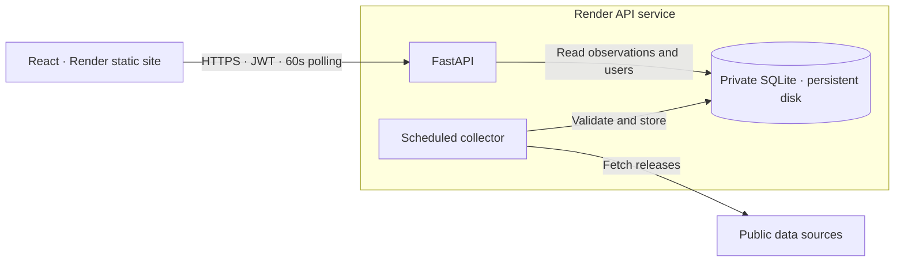

# Economic Indicators Dashboard

A React and FastAPI dashboard for six economic indicators, with historical charts, source provenance and JWT authentication. Explore available source-backed observations in **Live** mode or the complete illustrative presentation in **Seed** mode.

[](https://www.youtube.com/watch?v=ejHHga0vMKk)

**Application**

[](https://economic-dash-web.onrender.com)

**Backend**

[](https://economic-dash-api.onrender.com/docs)
[](https://economic-dash-api.onrender.com)
[](https://economic-dash-api.onrender.com/health)

**Evaluation access:** sign in with the test account supplied privately alongside the submission. There is no public registration or default account.

## Current status

| Area | Status |
| --- | --- |
| Application | Frontend and API deployed; six panels, interactive charts, history controls, authentication and Live/Seed modes implemented. |
| Data coverage | Five enabled source routes; Live coverage and history are partial. See [Data and limitations](#data-and-limitations). |
| Verification | Local automated checks passed; hosted startup, health and sign-in exercised. Full hosted security, collection and restart-persistence acceptance, plus exact Figma fidelity review, remain pending. |

## Explore the dashboard

The six panels cover **GDP growth, debt-to-GDP, imports/exports/trade balance, GST collection, inflation and government expenditure**, alongside a market ticker.

1. **Choose a mode:** Live shows available backend observations; Seed shows labelled frontend fixtures. Seed values never enter the database or fill Live gaps.
2. **Inspect a panel:** hover or keyboard-navigate chart points; open **Series details** for sources, history tables and available Live period/window controls.
3. **Check for updates:** **Refresh data** reads the API's stored view. It does not force an upstream collection.

While signed in to Live mode, the frontend schedules another API read about 60 seconds after the previous read completes. Seed pauses frontend Live reads; server-side collection continues independently. Missing values display as `—`; permitted retained observations are marked stale after failed or overdue checks.

## How it works

- **Frontend:** React, TypeScript, Vite and SVG charts; responsive layout targeting 1214 × 2159 CSS pixels.
- **Backend:** FastAPI, validated collection, parameterized SQL and ordered, checksummed schema migrations.
- **Authentication:** Argon2id password hashes and 15-minute JWTs kept in browser memory. Reload, expiry and sign-out require a new sign-in.
- **Hosting:** separate Render static-site and API services. SQLite lives on the API's persistent disk at `/var/data/economic-dash/dashboard.sqlite3`, with no database network listener or public file route.



## Data and limitations

NSE was assessed first. The five enabled public alternatives below are explicitly labelled **non-NSE** in the interface. Acquisition, definition or reuse conditions remain unresolved for the blocked requirements.

| Live data | Public source | Meaning and refresh checks |
| --- | --- | --- |
| India GDP | [MoSPI via PIB](https://www.pib.gov.in/PressReleasePage.aspx?PRID=2269286) | Annual real growth (%), financial years; weekly, daily in February/May/June |
| World GDP | [World Bank WDI](https://data.worldbank.org/indicator/NY.GDP.MKTP.KD.ZG) | Annual real growth (%), calendar years; weekly |
| Trade | [Commerce Ministry via PIB](https://www.pib.gov.in/PressReleasePage.aspx?PRID=2323944) | Monthly merchandise exports/imports (USD billion); balance = exports − imports; daily, every 6 hours on days 12–18 |
| Inflation | [MoSPI via PIB](https://www.pib.gov.in/PressReleaseIframePage.aspx?PRID=2322244&lang=2&reg=48) | Monthly CPI year-on-year (%); daily, every 6 hours on days 10–16 |
| Government expenditure | [Finance Ministry via PIB](https://www.pib.gov.in/PressReleasePage.aspx?PRID=2317034) | Financial-year cumulative amounts (₹ crore), not monthly flows; daily, every 12 hours on days 1–7 and 25–31 |

Schedules use IST and describe checking frequency, not guaranteed publication dates. Release links identify selected publications; panels expose actual observation periods, source/as-of information and available history. Comparisons require matching definitions and periods; rate changes use percentage points, amount changes use percentages.

**Live gaps:** debt-to-GDP and the India/US comparison, GST total and monthly average, RBI target and all three market quotes remain unavailable pending verified acquisition, definition or reuse resolution. History can be partial; inconsistent releases are excluded. Seed demonstrates their presentation without completing these Live requirements. See the [source catalog](backend/app/data/source-catalog.json) for definitions, transformations and source gates.

## Run locally

Requires **Python 3.13.7**, **Node.js 24.19.0** and **npm 11.17.0**. Commands below use PowerShell; on Linux/macOS, use `.venv/bin/python` and `cp` instead of the Windows executable path and `Copy-Item`.

Clone the repository, then prepare the backend:

```powershell
git clone https://github.com/git4alauddin/economic-dash.git
cd economic-dash/backend
python -m venv .venv
.\.venv\Scripts\python.exe -m pip install -r requirements.txt
Copy-Item .env.example .env
.\.venv\Scripts\python.exe -c "import secrets; print(secrets.token_hex(32))"
```

Add an uncommented `AUTH_JWT_SIGNING_KEY=<generated key>` line to `backend/.env`. Then create a local account and start the API:

```powershell
.\.venv\Scripts\python.exe -m app.auth.provision --username evaluator
.\.venv\Scripts\python.exe run.py
```

Choose a private password of 15–128 characters at the hidden prompt. Provisioning and API startup apply migrations automatically; local SQLite lives under `backend/.runtime/database/`. Local and hosted accounts are separate.

In a second terminal, from the repository root:

```powershell
cd frontend
Copy-Item .env.example .env
npm ci
npm run dev
```

Open **http://127.0.0.1:5173**. API: **http://127.0.0.1:8000**; interactive API reference: **http://127.0.0.1:8000/docs**.

### Essential configuration

| Variable | Purpose |
| --- | --- |
| `VITE_API_BASE_URL` | Frontend's API origin; rebuild the frontend when changing a deployed value |
| `AUTH_JWT_SIGNING_KEY` | Backend-only secret: 32 random bytes encoded as 64 hex characters |
| `CORS_ALLOWED_ORIGINS` | JSON list of exact frontend origins; production allows only `["https://economic-dash-web.onrender.com"]` |
| `APP_ENV` | `development` locally; `production` on Render |
| `DATABASE_DIRECTORY` | Private database directory; production: `/var/data/economic-dash` |
| `COLLECTOR_SCHEDULER_STATE_DIRECTORY` | Shared collector-lock directory; same production path as the database |

Defaults and optional settings: [backend example](backend/.env.example), [frontend example](frontend/.env.example). Production settings: [backend](backend/.env.production.example), [frontend](frontend/.env.production.example) and [Render Blueprint](render.yaml). Keep credentials and actual `.env` files outside Git.

## API at a glance

Use [Swagger UI](https://economic-dash-api.onrender.com/docs) to explore requests and responses, or download the [OpenAPI schema](https://economic-dash-api.onrender.com/openapi.json). To try protected routes, execute `POST /api/v1/auth/login` with your privately supplied credentials, copy `access_token`, then paste the token alone into **Authorize → DashboardBearer**. Authorization is not persisted across page reloads; tokens expire after 15 minutes by default.

| Method and route | Access / purpose |
| --- | --- |
| `GET /` | Public API identity |
| `GET /health` | Public database readiness: 200 `{"status":"ok"}` or 503; does not certify source freshness |
| `POST /api/v1/auth/login` | JSON `{"username":"<username>","password":"<password>"}`; returns an access token, expiry and user |
| `GET /api/v1/auth/me` | Current authenticated identity |
| `GET /api/v1/dashboard` | All six panels and ticker |
| `GET /api/v1/indicators` | Indicator definitions and available periods |
| `GET /api/v1/indicators/{id}` | One panel; optional repeated `period=series_id:period_id` |
| `GET /api/v1/indicators/{id}/history` | One series; required `series_id`, optional `end_period_id` |
| `GET /api/v1/ticker` | Market quotes with explicit availability states |

Except the public routes and login, send `Authorization: Bearer <access_token>`. Dashboard, catalog, panel and history routes accept `window=1..24`. Data reads return `{data, meta}`; economic decimals are strings or `null`. Errors use `{error: {code, message, details}}`. Unchanged conditional reads may return 304. Full shapes are in [API models](backend/app/api_models.py).

## Verification and deployment

From `backend/`:

```powershell
.\.venv\Scripts\python.exe -m unittest discover -s tests
```

From `frontend/`:

```powershell
node --test scripts/test-*.mjs
npm run build
```

Optional history collection, from `backend/`: `.\.venv\Scripts\python.exe -m app.collectors.refresh --history`. This fetches reviewed history from enabled sources and writes validated records; it requires upstream access and skips an overlapping collection.

The [Render Blueprint](render.yaml) defines separate frontend/API services, one API worker/collector and a 1 GB persistent disk. Deployments are manual. Provision hosted accounts in the running API's Shell with `python -m app.auth.provision --username evaluator`; local accounts do not transfer. Keep credentials private and use SQLite-consistent backups before schema changes; code rollback does not restore the database.

**Runtime maintenance:** the last verified Linux SQLite runtime was 3.51.1. A patched-build review remains open for the upstream [WAL-reset issue](https://www.sqlite.org/wal.html#walresetbug), fixed in 3.51.3 and later; the earlier startup compatibility fix does not establish that this issue is patched.
